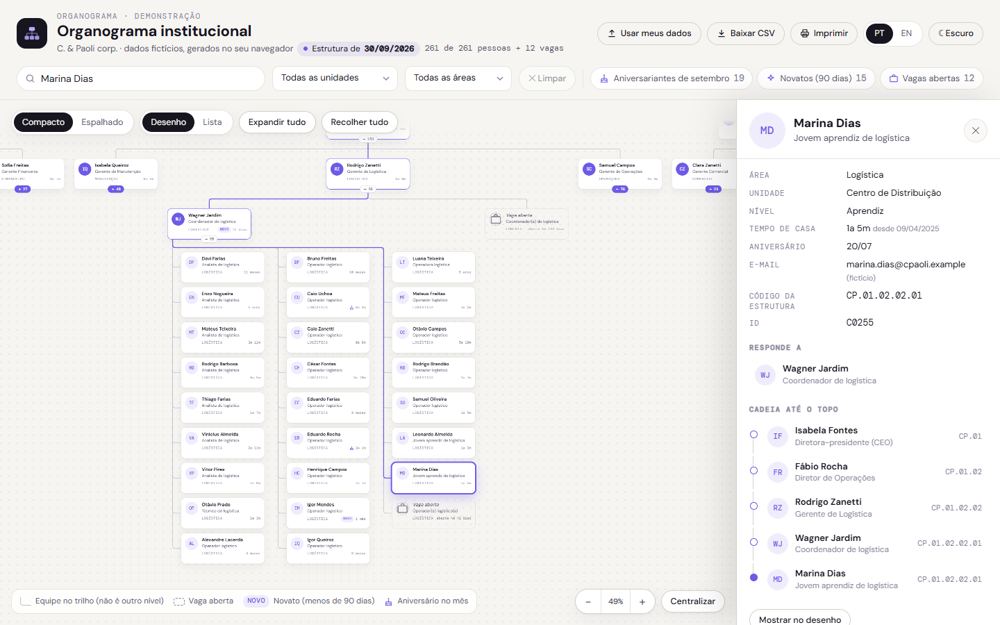
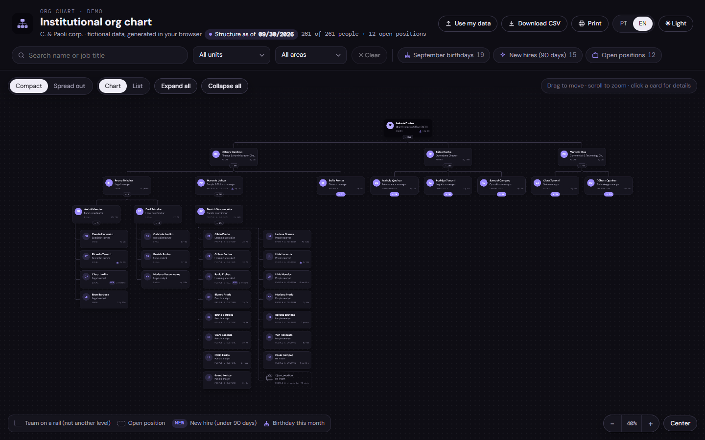
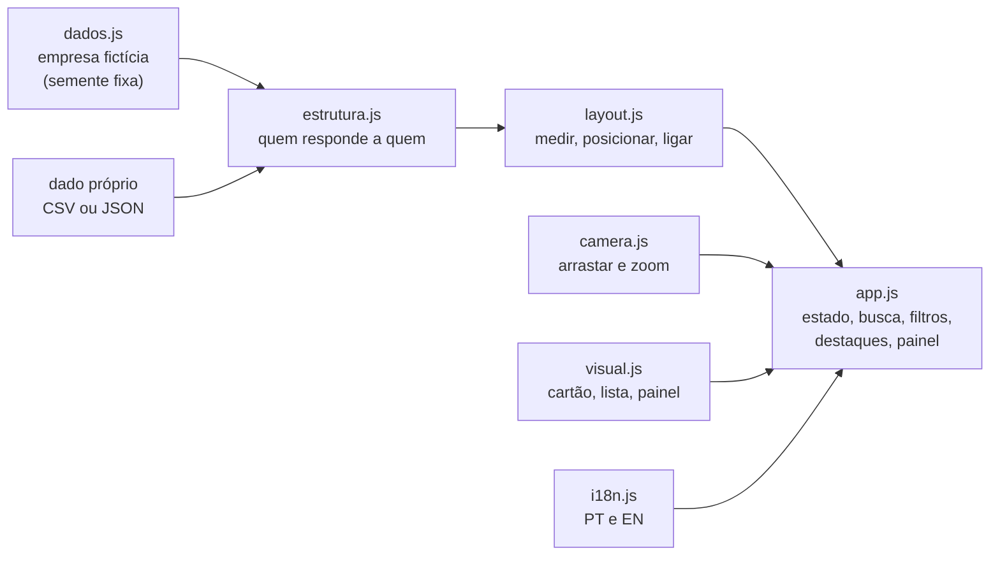

# Organograma Institucional 2

Organograma interativo da **C. & Paoli corp.**, a empresa fictícia das demos deste portfólio: 261 pessoas, 12 vagas abertas, cinco níveis de liderança. Busca, filtros, destaques, modo compacto e espalhado, lista em árvore no celular, CSV e impressão. Português e inglês, tema claro e escuro, sem build e sem biblioteca: é abrir o `index.html`.

É a versão 2 do [Organograma Institucional](https://github.com/FernandoTRecruiter/PowerBI.Circular.Organizational.Structure), que era uma medida DAX para o Power BI. Esta foi refeita do zero para o navegador e continua tendo um [modo Power BI](powerbi/LEIA-ME.md).



## Sumário

1. [Por que existe](#por-que-existe)
2. [O que tem](#o-que-tem)
3. [Como o desenho cabe na tela](#como-o-desenho-cabe-na-tela)
4. [Como usar](#como-usar)
5. [Plugar dado próprio](#plugar-dado-próprio)
6. [Modo Power BI](#modo-power-bi)
7. [Testes](#testes)
8. [Estrutura do repositório](#estrutura-do-repositório)
9. [Decisões e limitações](#decisões-e-limitações)
10. [English summary](#english-summary)

## Por que existe

Nasceu de um organograma que construí no trabalho, que vive dentro de um painel de pessoas. Ali apareceram três problemas que todo organograma grande tem:

1. **O retângulo infinito.** Com algumas centenas de pessoas, o desenho clássico (todo mundo lado a lado) vira uma faixa de dezenas de milhares de pixels de largura. Aqui, com os mesmos 273 cartões, o clássico mede **66.212 px** de largura; o compacto, **9.716 px**.
2. **"Onde está fulano?"** Rolar atrás de um nome não escala. A busca leva até o cartão e acende o caminho até o topo.
3. **Dado de RH muda toda semana.** O formato de entrada é uma tabela simples (quem responde a quem), que qualquer sistema de RH exporta.

| Pergunta de quem usa | Onde o organograma responde |
|---|---|
| "Quem é o gestor de fulano? E acima dele?" | Busca por nome ou cargo: centraliza o cartão, acende os fios até o topo e o painel mostra a **cadeia até o topo** |
| "Quantas pessoas tem nesse ramo?" | A pílula embaixo de cada líder mostra a contagem do ramo (e recolhe ou expande) |
| "Onde estão as vagas?" | Cartões **tracejados** no lugar da vaga, e o destaque **Vagas abertas** lista há quantos dias cada uma está aberta |
| "Quem faz aniversário este mês? Quem acabou de chegar?" | Destaques **Aniversariantes do mês** e **Novatos (menos de 90 dias)**: realçam os cartões e listam no painel |
| "Quero só a fábrica" ou "só a Logística" | Filtros de unidade e área, mantendo a cadeia até o topo para o desenho nunca ficar solto |
| "Preciso disso numa planilha / no papel" | **Baixar CSV** (a visão atual) e **Imprimir** (a visão atual, em papel claro) |
| "Abro no celular?" | No celular o desenho vira uma **lista em árvore** com o mesmo detalhe ao tocar |

## O que tem

- **Cartão de pessoa** com uma anatomia só: iniciais no lugar da foto, nome, cargo, área, tempo de casa e selos (novo, aniversário). Líder tem o avatar cheio; o topo, o cartão escuro.
- **Conectores em SVG** com quinas arredondadas, um caminho por pessoa (é o que permite acender só a cadeia de quem foi achado).
- **Compacto e espalhado**: um botão troca entre o desenho que cabe na tela e o clássico, todo mundo lado a lado. Os cartões **deslizam** de um arranjo para o outro, o cartão que você está olhando fica parado e nenhum cartão passa por cima de outro no caminho (ver [Como o desenho cabe na tela](#como-o-desenho-cabe-na-tela)).
- **Navegar como num mapa**: arrastar para mover; roda do mouse (ou pinça) para zoom no ponto do cursor; dois dedos no touchpad ou `Shift` + roda para andar; setas do teclado; duplo clique (num líder mostra o ramo inteiro, no fundo aproxima); **Centralizar**, `+`, `-` e clique no número do zoom para voltar a 100%.
- **Recolher e expandir ramos** pela pílula do líder, e **Expandir tudo** ou **Recolher tudo**. Recolher não tira o cartão do lugar; abrir um ramo que não cabe na tela faz a tela afastar até mostrar o ramo inteiro.
- **Painel de detalhes** ao clicar: área, unidade, nível, tempo de casa, aniversário, e-mail (fictício), código da estrutura, equipe direta, pessoas no ramo, a **cadeia até o topo** (cada nome leva ao cartão) e **Ver o ramo inteiro**.
- **Busca** sem acento por nome ou cargo, com teclado (`/` para buscar, setas, Enter, Esc).
- **Filtros** de unidade e área e **contagem** "N de 261 pessoas" no cabeçalho.
- **Destaques**: vagas abertas, aniversariantes do mês e novatos.
- **Exportar**: CSV da visão atual (abre no Excel com acento) e impressão da visão atual (`window.print` com CSS de impressão: some a barra, fica o desenho, em papel claro mesmo no tema escuro).
- **Celular**: lista em árvore indentada, com o mesmo painel em tela cheia.
- **Dado próprio**: colar CSV ou JSON (ou escolher o arquivo), sem nada sair do navegador.
- **PT e EN** completos (inclusive cargos e datas) e **tema claro e escuro**; a escolha fica salva no navegador.



## Como o desenho cabe na tela

O motor de layout (`js/layout.js`) trabalha em três passadas, sem flexbox aninhado:

1. **Medir**, de baixo para cima: cada ramo vira uma caixa (largura e altura) com a receita de como os filhos foram arrumados.
2. **Posicionar**, de cima para baixo: a receita vira coordenada.
3. **Ligar**: com as coordenadas prontas, cada pessoa ganha o caminho até o gestor.

No modo **compacto**, duas regras fazem o desenho caber:

- **Equipe pendurada no trilho.** Quem não tem ninguém abaixo fica em colunas (no máximo 10 por coluna) ligadas a um trilho na lateral. Lê-se como a lista da equipe, não como mais um nível, e a legenda diz isso.
- **Muitos sublíderes quebram em linhas.** Um líder com mais de 6 ramos abaixo arruma os ramos em linhas equilibradas, também com o trilho à esquerda.

O trilho corre num corredor reservado ao lado dos cartões, então **nenhum fio atravessa cartão**. Isso não é promessa: o teste automático percorre cada segmento de cada fio contra cada cartão, nos dois modos.

**Trocar de modo sem pular.** A troca usa a técnica FLIP: cada cartão já nasce no lugar novo, mas começa desenhado no antigo e desliza até lá, com os fios escondidos durante o movimento. Três cuidados:

- **Âncora parada:** o cartão mais perto do centro da tela fica no mesmo ponto, porque o desenho inteiro é deslocado em volta dele. A câmera não precisa se mexer.
- **Um eixo de cada vez:** para o espalhado, primeiro de lado e depois na vertical; na volta, o contrário. Os dois modos usam a mesma ordem de irmãos, então cartões na mesma faixa nunca trocam de lado e nenhum passa por cima de outro. O teste pausa a animação em 10 pontos de cada sentido e confere 0 sobreposição.
- **Sem salto em clique duplo:** a posição de partida é lida do próprio cartão; se outra transição estiver no meio, a nova parte de onde ele está.

Com as equipes recolhidas, os dois modos desenham igual, e a tela avisa em vez de parecer quebrada.



## Como usar

**Ver:** abra o `index.html` em qualquer navegador. Não precisa de servidor.

**Parâmetros de endereço** (úteis para link e para teste): `?lang=en` · `tema=escuro` · `modo=espalhado` · `vista=lista` · `sel=C0255` (abre já selecionando alguém pelo id).

**Teclado:** `/` busca · `Esc` fecha o que estiver aberto · setas andam (`Shift` anda mais) · `+` `-` zoom · `0` centraliza · `Enter` abre o cartão em foco (na pílula, recolhe o ramo).

**Publicar de graça no GitHub Pages:** suba a pasta para um repositório, vá em **Settings > Pages > Deploy from a branch**, escolha `main` e `/ (root)`. Em 1 a 2 minutos o organograma fica em `https://SEU-USUARIO.github.io/NOME-DO-REPOSITORIO/`. Para dado de verdade, leia antes [Plugar dado próprio](#plugar-dado-próprio): página pública mostra para todo mundo o que estiver nela.

## Plugar dado próprio

O formato é uma tabela com **uma linha por pessoa ativa** (e, se quiser, uma por vaga aberta). A hierarquia vem de uma coluna só: `gestor_id`.

| Coluna | Obrigatória | O que é |
|---|---|---|
| `id` | sim | identificador único (matrícula, chapa, qualquer texto) |
| `nome` | sim | nome da pessoa (vazio = vaga) |
| `cargo` | sim | cargo |
| `gestor_id` | sim | o `id` do gestor direto; **vazio no topo** (pode haver mais de um topo) |
| `area` | não | área ou departamento (vira filtro) |
| `unidade` | não | unidade, filial ou site (vira filtro) |
| `nivel` | não | nível ou senioridade (ordena os irmãos: liderança primeiro) |
| `nivel_ordem` | não | número para ordenar os níveis (0 = mais júnior); sem ele, a ordem sai do nome do nível |
| `admissao` | não | data de admissão, `AAAA-MM-DD` ou `DD/MM/AAAA` (tempo de casa e novatos) |
| `aniversario` | não | `DD/MM`; se vier a data inteira, o ano é descartado |
| `email` | não | e-mail |
| `codigo_estrutura` | não | código da seção ou centro de custo |
| `tipo` | não | `pessoa` ou `vaga` |
| `abertura`, `etapa` | não | para vagas: data de abertura e etapa (`triagem`, `entrevistas`, `oferta`) |

Nomes de coluna em inglês e os mais comuns de sistema de RH também valem (`name`, `title`, `manager_id`, `department`, `hire_date`, `birthday`, `matricula`, `departamento`...). O **Baixar CSV** sai no idioma da tela (cabeçalho e valores) e os dois voltam pelo **Usar meus dados**. Se o `gestor_id` não bater com nenhum `id`, o organograma tenta pelo **nome** do gestor. O separador do CSV pode ser `;`, `,` ou TAB.

```csv
id;nome;cargo;gestor_id;area;unidade;admissao;aniversario
1;Ana Exemplo;Diretora-presidente;;Diretoria;Matriz;2015-08-18;27/09
2;Bruno Exemplo;Gerente Financeiro;1;Financeiro;Matriz;2019-03-01;14/02
3;Clara Exemplo;Analista Financeira;2;Financeiro;Remoto;2026-08-10;03/11
4;;Analista Financeiro(a);2;Financeiro;Matriz;;
```

O mesmo em JSON (uma lista, ou um objeto com `empresa`, `dataRef` e `pessoas`):

```json
{ "empresa": "Minha empresa", "dataRef": "2026-09-30",
  "pessoas": [ { "id": "1", "nome": "Ana Exemplo", "cargo": "Diretora-presidente", "gestor_id": "" },
               { "id": "2", "nome": "Bruno Exemplo", "cargo": "Gerente Financeiro", "gestor_id": "1" } ] }
```

**Três jeitos de plugar:**

1. **Na tela:** botão **Usar meus dados**, cole o CSV ou JSON (ou escolha o arquivo) e **Carregar**. Nada sai do seu navegador e nada fica salvo: recarregar volta a empresa fictícia. O **Baixar modelo em CSV** baixa a empresa fictícia já no formato, para servir de molde.
2. **Fixo no código** (para publicar internamente): crie `js/dados-proprios.js` com `window.ORGANOGRAMA_DADOS = { empresa: "...", dataRef: "AAAA-MM-DD", pessoas: [ ... ] };` e inclua `<script src="js/dados-proprios.js"></script>` no `index.html`, **antes** do `app.js`. Esse nome de arquivo já está no `.gitignore`, para dado real não subir por engano.
3. **No Power BI:** veja [Modo Power BI](#modo-power-bi).

**O que acontece com dado torto:** id repetido (fica a primeira linha), gestor que não existe (a pessoa vira topo) e ciclo (A responde a B, que responde a A: o elo que fecha a volta é cortado) viram **aviso na tela**, em vez de travar.

**Privacidade:** o aniversário guarda só dia e mês. Não inclua coluna que o público da página não pode ver (salário, documento). Página no GitHub Pages é pública.

## Modo Power BI

`python powerbi/gera_powerbi.py` gera uma medida DAX (`powerbi/MedidaOrganograma.dax`) que monta o organograma inteiro dentro do visual **HTML Content**, lendo a tabela de pessoas do seu modelo (segmentações e RLS valem). É o mesmo caminho da v1. O passo a passo, o formato da tabela e os limites estão em [powerbi/LEIA-ME.md](powerbi/LEIA-ME.md). Honesto: o HTML único e o formato da medida foram provados aqui (item 15 dos testes), mas **ainda não foi aberto dentro do Power BI**.

## Testes

Um navegador de verdade (Edge ou Chrome headless, pelo DevTools Protocol) abre a página e confere 17 itens, cada um com o número que decidiu:

1. Sem erro de JavaScript em 12 combinações (PT/EN × claro/escuro × desenho compacto, espalhado e lista), com painel, destaque e janela de dados abertos.
2. Nenhuma chave de tradução faltando e nenhum travessão na tela.
3. Cartões de pessoa = pessoas ativas na data, **id por id**, contadas direto do gerador (261) e vagas tracejadas = vagas abertas (12).
4. Todo cartão tem gestor que existe no desenho, menos o topo (exatamente 1).
5. Nenhum cartão sobreposto e nenhum fio atravessando cartão, nos dois modos.
6. O compacto é pelo menos 4 vezes mais estreito que o espalhado.
7. A busca acha pelo nome, centraliza o cartão (desvio de 0 px), acende o caminho até o topo e abre o painel; e ignora acento ("debora" acha "Débora").
8. Mouse de verdade: clique abre o painel; arrastar move 200 × 50 px sem abrir nada; a roda dá zoom sem tirar do lugar o ponto sob o cursor. Rolagem lateral (touchpad, `Shift` + roda) anda sem zoom, a seta anda e o clique no número do zoom volta a 100%.
9. Filtro reduz (261 para 21 no Centro de Distribuição, conferido no gerador) e Limpar volta.
10. Recolher esconde o ramo inteiro sem tirar o cartão do lugar; expandir devolve. Pelo teclado de verdade, Enter na pílula também recolhe, e dar foco num cartão fora da tela não desalinha o desenho.
11. Destaques batem com o gerador: 19 aniversariantes, 15 novatos, 12 vagas.
12. O CSV tem uma linha por cartão e, colado de volta como dado próprio, desenha a mesma árvore (também o CSV em inglês); CSV com aspas, vírgula no nome e gestor inexistente é lido e avisado.
13. Na impressão, barra e botões somem e o desenho fica.
14. Celular (390 px): lista em árvore, nada vaza para o lado, tocar abre o detalhe em tela cheia.
15. Modo Power BI: o HTML único abre sem internet e sem erro; com o dado no formato da medida, desenha a mesma árvore da demo.
16. Transição compacto e espalhado, com tudo aberto: 272 cartões deslizando, animação pausada em 10 pontos de cada sentido, 0 sobreposição em todos os quadros, âncora parada (0,0 px), fios escondidos no caminho e de volta no fim.
17. Idiomas: em inglês, nenhum acento ou palavra de português na tela fora nome próprio; em português, nenhum rótulo em inglês. Lê o texto da tela, as dicas dos botões e os textos de exemplo, com painel, destaque, janela de dados e lista abertos.

```bash
pip install websocket-client
python tests/teste_organograma.py
```

Precisa de Edge ou Chrome instalado (ou `NAVEGADOR=/caminho/do/navegador`). Sai com código 1 se algo falhar; as fotos de conferência ficam em `tests/fotos/` (fora do repositório).


## Estrutura do repositório

```
organograma-institucional-2/
├── index.html              a página (carrega os scripts na ordem)
├── css/organograma.css     identidade, temas e impressão
├── js/
│   ├── dados.js            a empresa fictícia (cópia idêntica do gerador da demo de People Analytics)
│   ├── estrutura.js        lista -> árvore; leitura de CSV/JSON; exportação
│   ├── i18n.js             todos os textos, PT e EN
│   ├── layout.js           o motor de layout (medir, posicionar, ligar)
│   ├── camera.js           arrastar, zoom e enquadrar
│   ├── visual.js           moldes do cartão, da lista e do painel
│   └── app.js              estado, busca, filtros, destaques, eventos
├── powerbi/                gerador, medida DAX, HTML único e exemplo (ver LEIA-ME)
├── tests/                  teste automático e o utilitário do navegador
└── docs/img/               as fotos deste README
```

## Decisões e limitações

**Como a hierarquia fictícia é montada** (`js/estrutura.js`, regra fixa, sem sorteio): a pessoa mais antiga da Diretoria é a CEO; as outras três dirigem Operações (Operações, Manutenção, Logística), Comercial e Tecnologia, e Administrativo-Financeiro (Financeiro, Pessoas & Cultura, Jurídico). Cada área tem um gerente; coordenadores respondem ao gerente; cada pessoa da equipe vai para o coordenador **da mesma unidade com menos gente** (sem coordenador, para o gerente). Entra só quem está ativo em 30/09/2026. As vagas tracejadas são as 12 vagas abertas do mesmo gerador. Cargo, e-mail (`@cpaoli.example`, domínio reservado que não existe) e código de estrutura são inventados aqui.

**Por que o gerador é cópia idêntica:** para as pessoas baterem entre os projetos do portfólio. As mesmas 261 pessoas estão na [demo de People Analytics](https://fernandotrecruiter.github.io/people-analytics-dashboard/).

**Data de referência, não o relógio:** aniversariantes do mês e novatos contam a partir da data da estrutura (30/09/2026 na demo; com dado próprio, o `dataRef` informado ou o dia de hoje). Assim a demo mostra sempre os mesmos números.

**Limitações conhecidas:**

- Sem foto: o cartão usa iniciais. Sem linha matricial (reporte pontilhado a um segundo gestor).
- Não edita o organograma na tela: a fonte da verdade é a planilha ou o sistema de RH.
- Exportar imagem é pela impressão (salvar como PDF); não há PNG.
- Testado com os 273 cartões da demo. Alguns milhares devem rodar, mas não foi medido.
- Em telas com menos de 1180 px de largura, a legenda e a dica de navegação somem para não brigar com os controles.
- O modo Power BI ainda não foi aberto dentro do Power BI (ver [powerbi/LEIA-ME.md](powerbi/LEIA-ME.md)).

## English summary

**Institutional Org Chart 2** is an interactive org chart for **C. & Paoli corp.**, the fictional company used across this portfolio (261 people, 12 open positions). It is version 2 of my [Power BI org chart](https://github.com/FernandoTRecruiter/PowerBI.Circular.Organizational.Structure), rebuilt from scratch for the browser: no build step, no libraries, PT/EN, light/dark.

- **Compact layout that fits the screen:** people without reports hang in columns on a side rail, and leaders with many sub-teams wrap into rows. Same 273 cards: 9,716 px wide compact versus 66,212 px in the classic spread-out view (one click away). A test walks every wire segment against every card: no wire crosses a card.
- **Smooth mode switch:** cards slide between layouts (FLIP), one axis at a time, while the card you are looking at stays still. The test pauses the animation at 10 points per direction: zero overlapping cards.
- **Find anyone:** search by name or job title centers the card, lights up the chain to the top and opens a detail panel (tenure, birthday, structure code, direct reports, chain to the top).
- **Highlights:** open positions as dashed cards, birthdays this month, new hires (under 90 days). Filters by unit and area keep the chain to the top.
- **Export:** CSV of the current view and print of the current view. On phones the chart becomes an indented tree list.
- **Plug in your own data:** paste a CSV or JSON with `id, nome (name), cargo (title), gestor_id (manager id)` plus optional columns. Nothing leaves your browser. English column names work too. Bad rows (duplicate ids, missing managers, cycles) become warnings, not crashes.
- **Power BI mode:** a generator builds a DAX measure for the HTML Content visual, like v1 (proven offline here, not yet opened inside Power BI).
- **Tests:** `python tests/teste_organograma.py` drives a real headless browser through 17 checks (counts against the generator, layout geometry, search centering, real mouse drag and wheel zoom, filters, collapse, CSV round trip, print CSS, 390 px phone, Power BI build, frame-by-frame mode transition, no Portuguese on the English screen and vice versa).

## Licença

MIT. Feito por [Fernando Paoli](https://github.com/FernandoTRecruiter) com o Claude Code como par.
