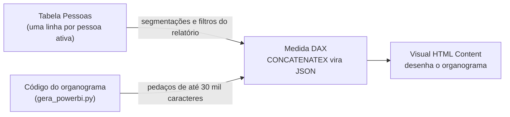

# O organograma dentro do Power BI

O mesmo organograma, rodando num visual **HTML Content** do Power BI e lendo a tabela de pessoas do seu modelo. É o caminho da v1 ([PowerBI.Circular.Organizational.Structure](https://github.com/FernandoTRecruiter/PowerBI.Circular.Organizational.Structure)): uma medida DAX monta o HTML inteiro e o visual desenha.

## Como funciona



1. `gera_powerbi.py` junta todo o CSS e JS num HTML só, sem internet, e divide em pedaços (o DAX não aceita texto com mais de ~32 mil caracteres).
2. A medida `MedidaOrganograma.dax` transforma as linhas da sua tabela em JSON com `CONCATENATEX` e entrega em `window.ORGANOGRAMA_DADOS`.
3. O organograma vê que chegou dado de verdade e usa ele no lugar da empresa fictícia (a leitura é a mesma do "Usar meus dados", em `js/estrutura.js`).
4. Segmentação e filtro do relatório filtram a tabela **antes** da medida. A segurança por linha (RLS) vale do mesmo jeito.

## A tabela: o que ela precisa ter

Uma linha por pessoa **ativa**. Vaga aberta pode entrar como linha com `Tipo` = "vaga" e nome vazio.

| Coluna no modelo (troque pelo seu nome) | Campo | Obrigatória |
|---|---|---|
| `[ID]` | id (único) | sim |
| `[Nome]` | nome | sim |
| `[Cargo]` | cargo | sim |
| `[GestorID]` | gestor_id (o ID do gestor; vazio no topo) | sim |
| `[Area]`, `[Unidade]` | area, unidade (viram os filtros) | não |
| `[Nivel]` | nivel (ordena os irmãos: liderança primeiro) | não |
| `[Admissao]` | admissao (data: tempo de casa e novatos) | não |
| `[Nascimento]` | aniversario (só dia e mês saem da medida) | não |
| `[Tipo]` | tipo ("pessoa" ou "vaga") | não |

Não tem uma coluna opcional? Ponha `--` no começo da linha dela na medida. Cada linha começa com a própria vírgula, então o resto continua valendo.

## Passo a passo

1. **Instale o visual**: Power BI Desktop > Visualizações > "Obter mais visuais" > procure **HTML Content** > Adicionar. É o visual da v1, que executa o JavaScript do HTML.
2. **(Para testar antes)** Importe `exemplo_organograma.csv` (separador `;`, UTF-8) como uma tabela chamada `Pessoas` e renomeie as colunas para `ID`, `Nome`, `Cargo`, `GestorID`, `Area`, `Unidade`, `Nivel`, `Admissao`, `Tipo` (ou troque os nomes na medida). Ele não tem nascimento: comente a linha `aniversario`. É a empresa fictícia da demo.
3. **Crie a medida**: Modelagem > Nova medida > apague o texto > cole o conteúdo de `MedidaOrganograma.dax` > Enter.
4. **Troque os nomes**: no topo da medida, troque `'Pessoas'` e cada `[Coluna]` pelos do seu modelo, e o `_empresa`. Não mexa nos blocos `_a1`, `_d1`... (são o código do organograma).
5. **Coloque na tela**: arraste o visual HTML Content, ponha a medida `OrganogramaHTML` em "Values" e estique o visual (recomendado 1280 x 800 ou mais).
6. **Confira**: com o CSV de exemplo, o desenho tem de dar **261** pessoas e **12** vagas, a mesma árvore da demo.

## Quando o código do organograma mudar

```
python powerbi/gera_powerbi.py
```

Depois cole a medida de novo (passo 3) e refaça só o passo 4. O gerador também refaz `organograma_powerbi.html` (para abrir no navegador e conferir) e `teste_powerbi.html` (o HTML lendo o CSV de exemplo do jeito que a medida entrega), que o teste automático abre.

## Limites e cuidados

- **Não testado dentro do Power BI ainda.** Daqui foi provado que o HTML único abre sem internet e sem erro, e que o dado no formato da medida desenha exatamente a mesma árvore da demo (item 15 de `tests/teste_organograma.py`). A primeira rodada no Power BI é com o CSV de exemplo, conferindo o passo 6.
- **Data da estrutura = hoje** (`TODAY()` na medida): aniversariantes do mês e novatos contam a partir da data em que o relatório é aberto.
- **Clique não filtra o relatório**: o que você clica dentro do organograma não filtra os outros visuais. O caminho contrário funciona: segmentações filtram o organograma.
- **Sem botões de arquivo**: dentro do visual, baixar CSV, imprimir e colar dados próprios somem (o visual não deixa baixar arquivo). Para imprimir, use a exportação do próprio Power BI.
- **Volume**: centenas a poucos milhares de pessoas rodam bem. Muito mais que isso deixa o visual lento, porque tudo vira texto dentro da medida.
- **Privacidade**: tudo o que entra na medida é visível para quem vê o relatório. Não acrescente coluna que o público não pode ver e use RLS se cada gestor só pode ver a própria equipe.
